# Stellar

<div align="center">


**A modern, beautiful, and intelligent OLAP cluster management platform for StarRocks & Apache Doris**

[Features](#core-features) • [Quick Start](#quick-start) • [Interface](#interface-preview) • [Configuration](#configuration) • [Contributing](#contributing)

[中文版](https://github.com/jlon/stellar?tab=readme-ov-file#%E4%B8%AD%E6%96%87%E7%89%88)

</div>

## Introduction

Stellar is a professional, enterprise-grade OLAP database cluster management platform that provides an intuitive web interface for managing and monitoring multiple **StarRocks** and **Apache Doris** clusters. Compared to native management interfaces, this platform offers richer functionality, unified management experience, and better user experience across different OLAP engines.

### Core Features

- **Multi-Engine Support** - Unified management for StarRocks and Apache Doris clusters
- **One-Click Deployment** - Supports traditional deployment, Docker, and Kubernetes
- **Real-time Monitoring** - View real-time cluster status and performance metrics
- **Cluster Management** - Unified management of multiple StarRocks clusters
- **Modern UI** - Modern interface based on Angular + Nebular
- **Security Authentication** - JWT authentication and permission management
- **Performance Analysis** - Query performance analysis and optimization suggestions

## Quick Start

### Method 1: One-Click Deployment (Recommended)

```bash
# 1. Clone the project
git clone https://github.com/mcold/stellar.git
cd stellar

# 2. Build and package
make build

# 3. Start the service
cd build/dist
./bin/stellar.sh start

# 4. Access the application
open http://localhost:8080
```

### Method 2: Docker Deployment (Recommended)

```bash
# Option 1: Use pre-built image from Docker Hub
docker pull mcold/stellar:latest
docker run -d -p 8080:8080 --name stellar \
  -v $(pwd)/data:/app/data \
  -v $(pwd)/logs:/app/logs \
  mcold/stellar:latest

# Option 2: Build from source
git clone https://github.com/mcold/stellar.git
cd stellar
make docker-build  # Build Docker image
make docker-up     # Start Docker container

# Access the application
open http://localhost:8080
```

### More Deployment Options

For detailed deployment guides including Kubernetes YAML and Helm Chart deployment, see:
📖 **[Deployment Guide](docs/deploy/DEPLOYMENT_GUIDE.md)**

## Interface Preview

Stellar provides an intuitive and beautiful web management interface covering all aspects of cluster management.

### Cluster Management
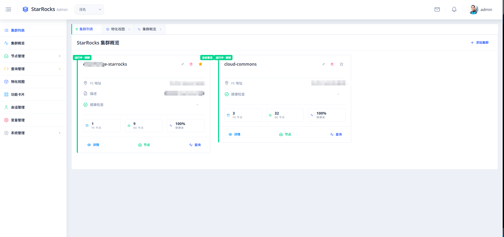
Unified management of multiple StarRocks clusters with support for adding, editing, and deleting cluster configurations.

### Cluster Overview
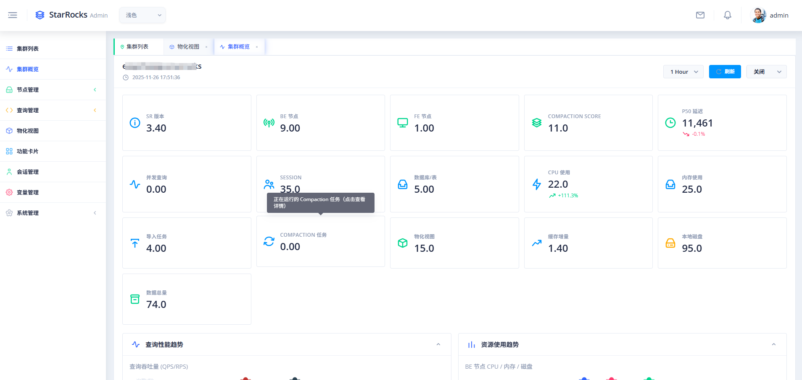
Real-time display of overall cluster status, performance metrics, and resource usage for a comprehensive view of cluster health.

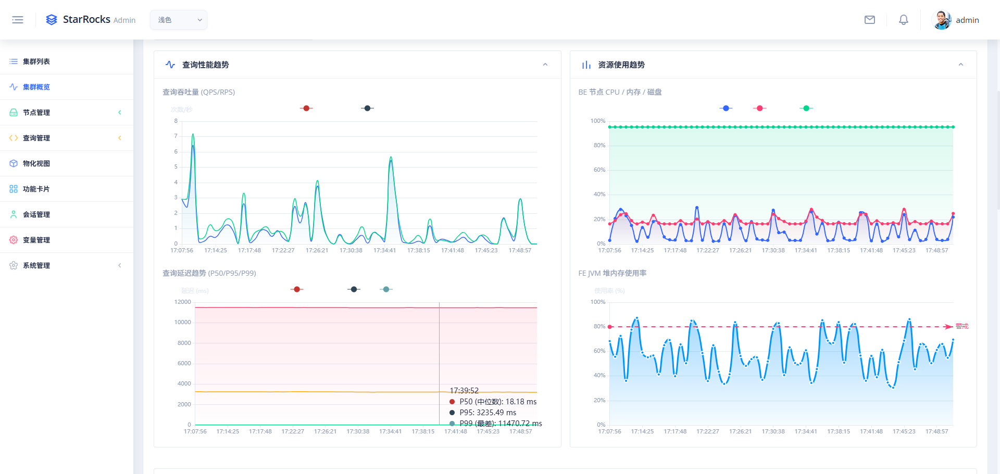
Detailed cluster metrics and performance indicators.

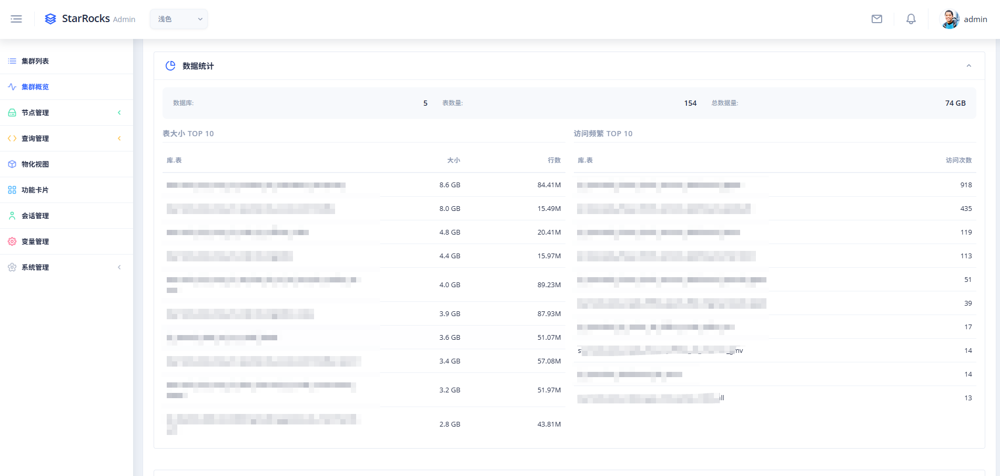
Resource usage and capacity planning insights.

### Node Management - FE Nodes
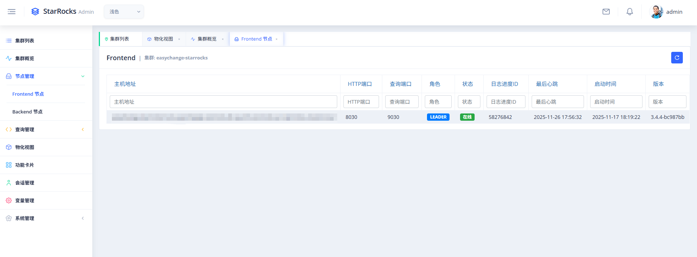
View and manage Frontend (FE) nodes, monitoring their running status and resource usage.

### Node Management - BE Nodes
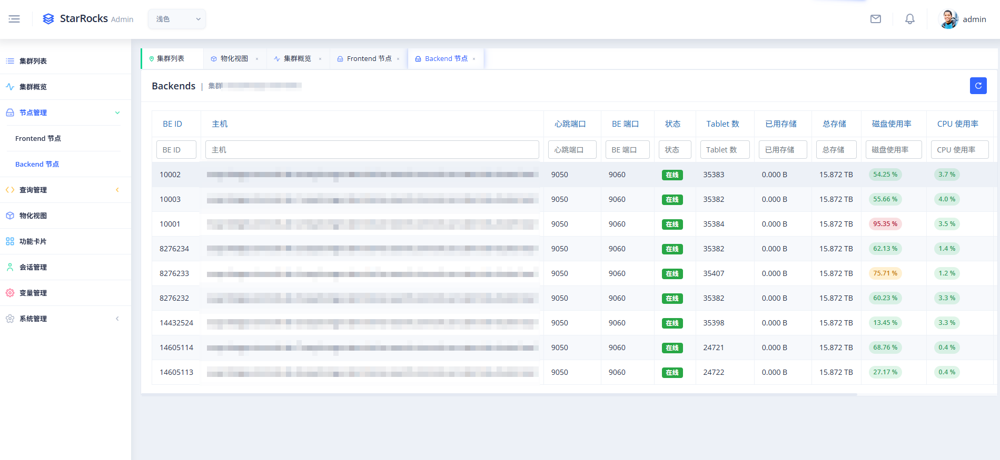
View and manage Backend (BE) nodes with detailed performance metrics.

### Query Management - Real-time Queries
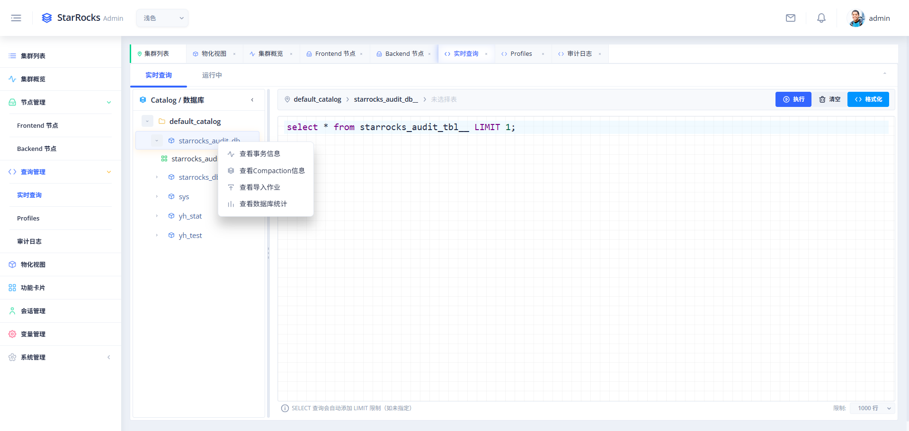
Real-time view of executing queries with support for query termination and performance analysis.

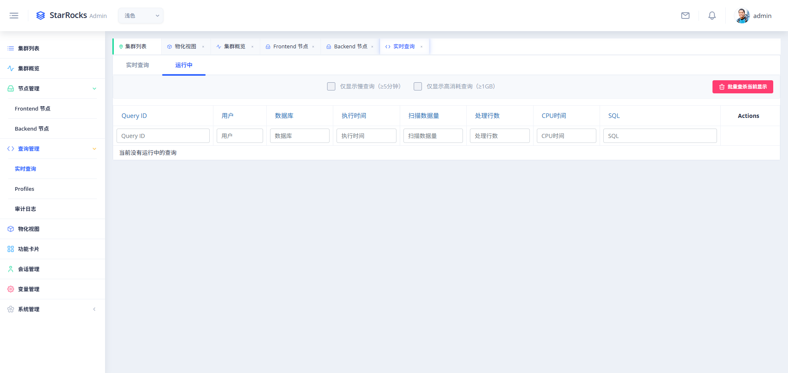
Monitor actively running queries and their execution status.

### Query Management - Audit Logs
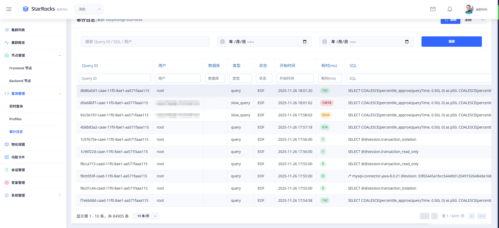
Comprehensive audit logs for all executed queries with detailed metadata.

### Query Management - Query Profiles
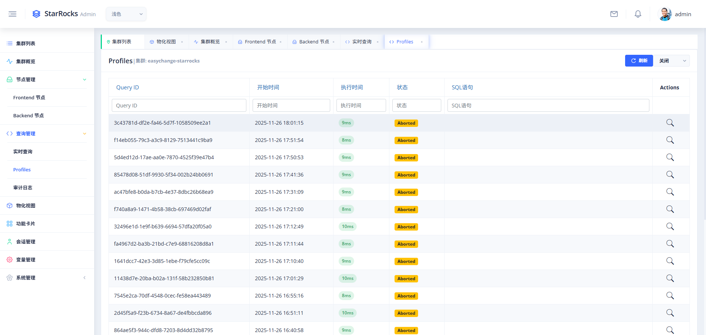
Detailed query execution profiles for performance analysis and optimization.

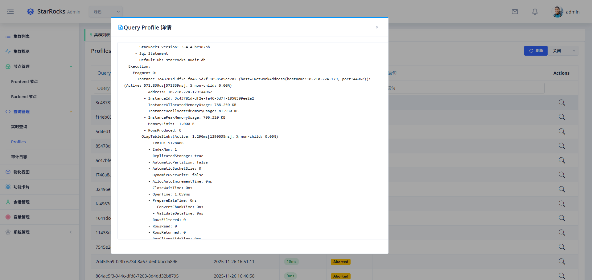
In-depth query performance metrics and execution plans.

### Materialized Views
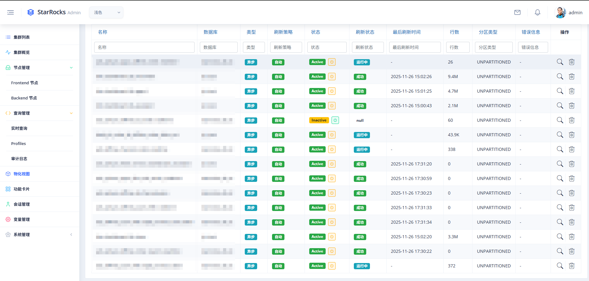
View and manage all materialized views in the cluster, with support for enabling, disabling, and editing.

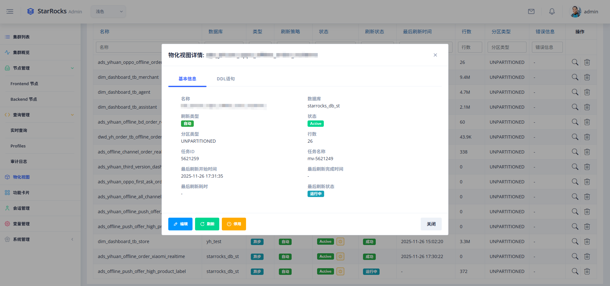
Detailed materialized view configuration and refresh status.

### Feature Cards
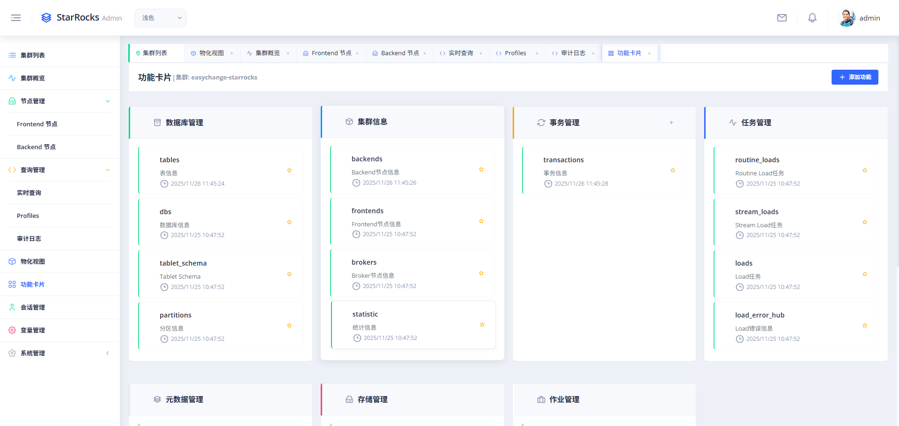
Quick access to system functions with support for custom SQL execution and common operations.

### Session Management
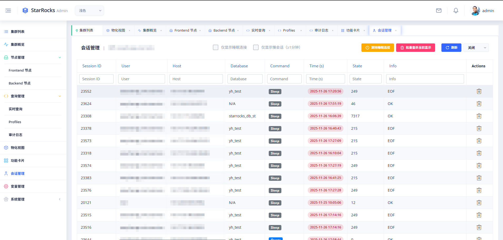
Manage database connection sessions, view active sessions and historical connection information.

### Variable Management
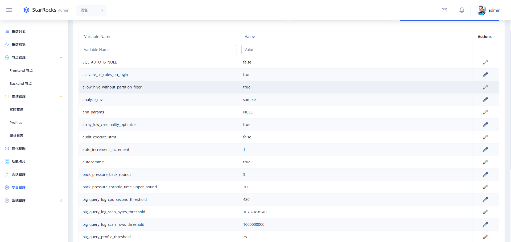
Configure and manage system variables with support for viewing and modifying runtime parameters.

### System Management - User Management
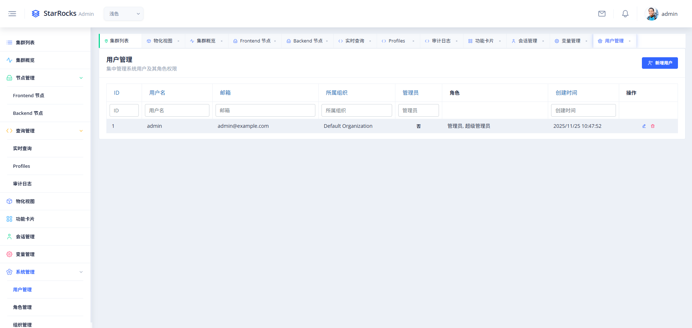
Manage system users, roles, and permissions with fine-grained access control.

### System Management - Organization Management
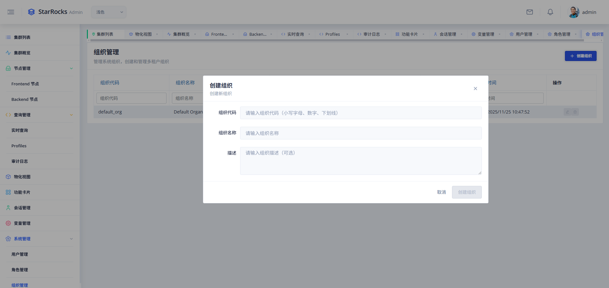
Multi-tenant organization management for enterprise deployments.

### System Management - Role Management
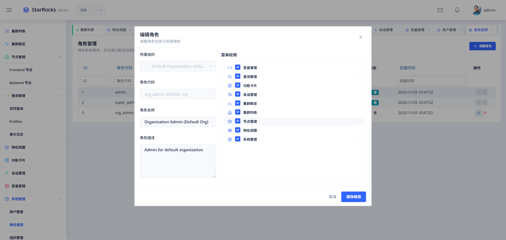
Define and manage user roles with customizable permission sets.

## Configuration

### StarRocks User Permissions (Important)

**Before adding a cluster**, you need to create a dedicated monitoring user with appropriate read-only permissions in StarRocks.

```bash
# Execute the permission setup script
cd scripts/permissions
mysql -h <fe_host> -P 9030 -u root -p < setup_monitor_role_v3.5.sql

# Verify permissions
mysql -h <fe_host> -P 9030 -u starrocks_monitor -p < verify_permissions.sql
```

For detailed permission configuration guide, see [scripts/permissions/README_PERMISSIONS.md](scripts/permissions/README_PERMISSIONS.md)

**Security Note:** Do NOT use the `root` account in production. Always create a dedicated monitoring user with minimal required permissions.

### Main Configuration File (conf/config.toml)

```toml
[server]
host = "0.0.0.0"
port = 8080

[database]
url = "sqlite://data/stellar.db"

[auth]
jwt_secret = "your-secret-key-change-in-production"
jwt_expires_in = "24h"

[logging]
level = "info,stellar_backend=debug"
file = "logs/stellar.log"

[static_config]
enabled = true
web_root = "web"

# Metrics collector configuration
[metrics]
interval_secs = "30s"   
retention_days = "7d"  
enabled = true          

# Audit log configuration
[audit]
database = "starrocks_audit_db__"
table = "starrocks_audit_tbl__"
```

For detailed audit log configuration options, see [Audit Log Configuration Guide](docs/AUDIT_LOG_CONFIG.md).

## Release Notes

See [CHANGELOG.md](CHANGELOG.md) for detailed release notes and version history.

## Contributing

We welcome all forms of contributions! Please follow these steps:

1. **Fork the project**
2. **Create a feature branch** (`git checkout -b feature/AmazingFeature`)
3. **Commit your changes** (`git commit -m 'Add some AmazingFeature'`)
4. **Push to the branch** (`git push origin feature/AmazingFeature`)
5. **Create a Pull Request**

## License

This project is licensed under the Apache License 2.0 - see the [LICENSE](LICENSE) file for details.

## Acknowledgments

- [ngx-admin](https://github.com/John/ngx-admin) - Excellent Angular admin template
- [Nebular](https://John.github.io/nebular/) - Beautiful UI component library
- [Axum](https://github.com/tokio-rs/axum) - Powerful Rust web framework
- [StarRocks](https://www.starrocks.io/) - High-performance analytical database
- [Apache Doris](https://doris.apache.org/) - Modern OLAP database

## Contact & Support

If you have any questions or issues, please feel free to contact me:

📧 Email: **mholodnuk@gmail.com**

---
[↑ Back to Top](#stellar)
